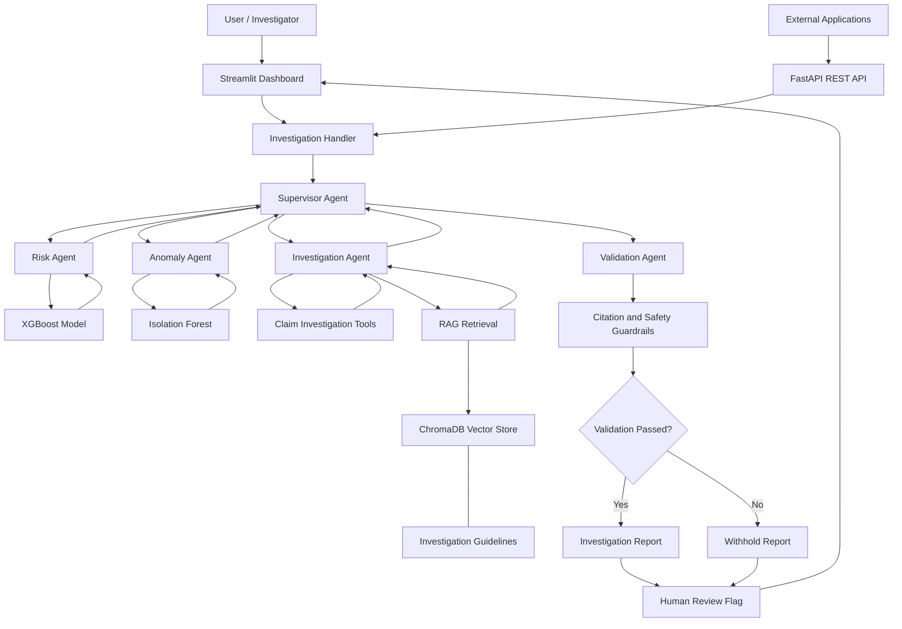

# Agentic AI Insurance Risk & Fraud Detection Platform

An end-to-end multi-agent AI platform that combines
traditional machine learning, Generative AI,
Retrieval-Augmented Generation (RAG), and intelligent
agent orchestration to support insurance risk assessment
and fraud investigations.

## Project Overview

Insurance fraud investigations often require analysts
to review multiple data sources, predictive model
outputs, claim characteristics, and investigation
guidelines.

This platform demonstrates how Agentic AI can
coordinate specialized analytical tools, retrieve
relevant knowledge, validate generated insights,
and produce evidence-based investigation reports.

The system uses 20,000 synthetic insurance claims
and is designed as a human-centered decision-support
platform rather than an automated claim denial system.

## Key Features

- Multi-agent orchestration using LangGraph
- Dynamic task routing through a Supervisor Agent
- XGBoost-based fraud risk assessment
- Isolation Forest-based anomaly detection
- Automated claim risk indicator identification
- Retrieval-Augmented Generation using ChromaDB
- Semantic search using OpenAI embeddings
- Structured AI-generated investigation reports
- Deterministic citation validation
- LLM-based validation and groundedness evaluation
- Prompt injection resistance testing
- Human review flags and fail-closed guardrails
- FastAPI REST API with Swagger documentation
- Interactive Streamlit dashboard
- Password-protected demonstration access
- Automated API testing using Pytest

## System Architecture



## Multi-Agent Architecture

| Agent | Responsibility |
|---|---|
| Supervisor Agent | Plans investigations and dynamically routes tasks |
| Risk Agent | Interprets XGBoost fraud risk scores |
| Anomaly Agent | Identifies unusual claim patterns |
| Investigation Agent | Reviews claim indicators and retrieves relevant guidelines |
| Validation Agent | Evaluates factual consistency, citations, and safety |

The Supervisor Agent selects the appropriate agents
based on the user's investigation request.

LangGraph maintains shared workflow state and
coordinates agent execution through conditional routing.

## Machine Learning Models

### Fraud Risk Assessment — XGBoost

A supervised classification model trained on
synthetic insurance claims.

Features include:

- Policy age
- Claim amount
- Vehicle value
- Previous claims
- Reporting delay
- Police report availability
- Witness count
- Repair estimate
- Claim-to-value ratio
- Claim-to-repair ratio

The training pipeline uses:

- Policy-level grouped train/test splitting
- Categorical feature encoding
- Class imbalance handling
- L1 and L2 regularization
- Reproducible model configuration

The model produces an uncalibrated fraud risk score,
not a verified probability of fraud.

### Anomaly Detection — Isolation Forest

An unsupervised machine learning model that identifies
unusual claim patterns without requiring fraud labels
during training.

Anomalous behavior is treated as a signal for further
investigation, not evidence of fraudulent activity.

## Retrieval-Augmented Generation

The RAG pipeline retrieves relevant information from
a fictional insurance investigation knowledge base.

Pipeline:

1. Document ingestion
2. Section-based text chunking
3. OpenAI text embeddings
4. ChromaDB vector storage
5. Cosine similarity search
6. Top-K document retrieval
7. Context-aware investigation generation
8. Source citation validation

The knowledge base contains ten investigation
guideline sections.

## Evaluation Framework

The platform includes evaluation scripts covering
traditional machine learning and Generative AI.

| Component | Evaluation Metrics |
|---|---|
| XGBoost | ROC-AUC, Average Precision, Precision@500, Recall@500 |
| Isolation Forest | ROC-AUC, Average Precision, Precision@500, Recall@500 |
| RAG Retrieval | Precision@K, Recall@K, MRR, Hit Rate |
| Agent Orchestration | Routing Accuracy, Task Completion, Latency |
| Citation Validation | Citation Accuracy, Unauthorized Citations |
| Guardrails | Adversarial Test Pass Rate, Validation Execution Rate |
| LLM Evaluation | Groundedness, Numerical Accuracy, Completeness, Safety |
| API | Automated Endpoint and Error Handling Tests |

Evaluation scripts generate reproducible results
and CSV reports where applicable.

LLM-based evaluations are quality indicators,
not independent ground truth.

## Responsible AI and Guardrails

The platform incorporates multiple safeguards:

- Synthetic data only
- Structured agent outputs
- Deterministic citation validation
- Evidence-based report generation
- Unsupported claim detection
- Adversarial prompt testing
- Validation before report release
- Withholding of failed investigations
- Human review flags
- No automated claim denial

Risk scores and anomalies are not proof of fraud.

## Technology Stack

| Category | Technologies |
|---|---|
| Programming | Python |
| Machine Learning | XGBoost, Scikit-learn |
| Data Processing | Pandas, NumPy |
| Agent Orchestration | LangGraph, LangChain |
| Large Language Model | OpenAI GPT-4.1-mini |
| Embeddings | OpenAI text-embedding-3-small |
| Vector Database | ChromaDB |
| Backend | FastAPI, Pydantic, Uvicorn |
| Frontend | Streamlit, Plotly |
| Testing | Pytest, HTTPX |
| Version Control | Git, GitHub |

## Repository Structure

```text
agentic-insurance-ai/
├── agents/
├── data/
├── models/
├── tools/
├── workflows/
├── knowledge_base/
├── guardrails/
├── evaluation/
├── tests/
├── api.py
├── streamlit_app.py
├── requirements.txt
├── .env.example
├── .gitignore
└── README.md
```

## Local Installation

### 1. Clone the repository

```bash
git clone https://github.com/mxsamadi/agentic-insurance-ai.git
cd agentic-insurance-ai
```

### 2. Create a virtual environment

```bash
python -m venv .venv
```

Windows PowerShell:

```powershell
.venv\Scripts\Activate.ps1
```

macOS / Linux:

```bash
source .venv/bin/activate
```

### 3. Install dependencies

```bash
pip install -r requirements.txt
```

### 4. Configure environment variables

Create a `.env` file in the project root:

```text
OPENAI_API_KEY=your_openai_api_key
```

Create `.streamlit/secrets.toml`:

```toml
DEMO_PASSWORD = "your_demo_password"
```

Never commit actual credentials to version control.

### 5. Initialize data, models, and knowledge base

```bash
python -m data.generate_data
python -m models.train_risk_model
python -m models.train_anomaly_model
python -m knowledge_base.ingest
```

### 6. Launch the dashboard

```bash
python -m streamlit run streamlit_app.py
```

Open:

http://localhost:8501

### 7. Launch the REST API

```bash
python -m uvicorn api:app --reload
```

Swagger documentation:

http://127.0.0.1:8000/docs

## API Endpoints

| Method | Endpoint | Description |
|---|---|---|
| GET | / | Platform information |
| GET | /health | Service liveness check |
| POST | /investigate | Execute an AI investigation |

Example request to POST /investigate:

```json
{
  "question": "Conduct a comprehensive fraud investigation for CLM-000001."
}
```

The response includes:

- Claim ID
- Risk score and risk level
- Anomaly score
- Selected and completed agents
- Validation status
- Human review flag
- Retrieved source references
- Investigation report
- Execution trace
- Processing latency

## Running Evaluations

```bash
python -m evaluation.evaluate_workflow
python -m evaluation.evaluate_rag
python -m evaluation.evaluate_guardrails
python -m evaluation.evaluate_groundedness
python -m pytest tests/test_api.py -v
```

## Business Applications

The architecture demonstrates potential applications in:

- Insurance fraud investigation
- Claims triage and prioritization
- Underwriting risk assessment
- Anomaly detection
- Financial crime investigation
- Regulatory compliance
- Enterprise AI decision support

## Limitations

This project is a portfolio demonstration using
synthetic data and fictional investigation guidelines.

The models are not validated for real-world insurance
decisions. LLM-based validation may miss unsupported
statements. Shared-password authentication and
session-level usage limits are demonstration controls,
not production-grade security.

Production deployment would require additional
model validation, calibration, security controls,
monitoring, governance, and regulatory review.

## Author

**Max Samadi, Ph.D.**

Data Scientist | Machine Learning | Generative AI |
Agentic AI | Applied Statistics

7+ years of industry experience in predictive modeling,
advanced analytics, insurance risk assessment,
and data-driven decision support.

GitHub: https://github.com/mxsamadi
